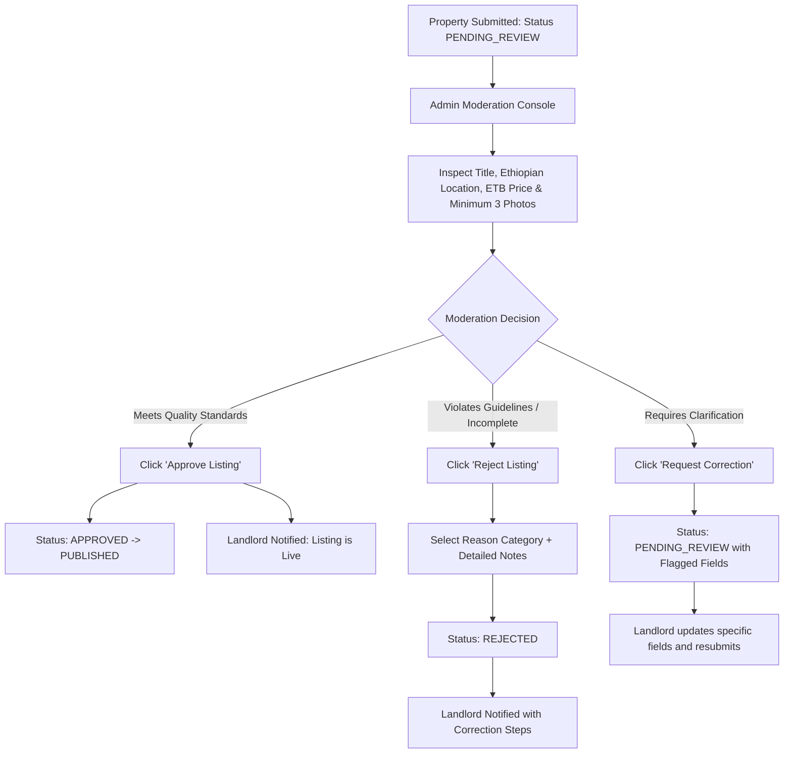
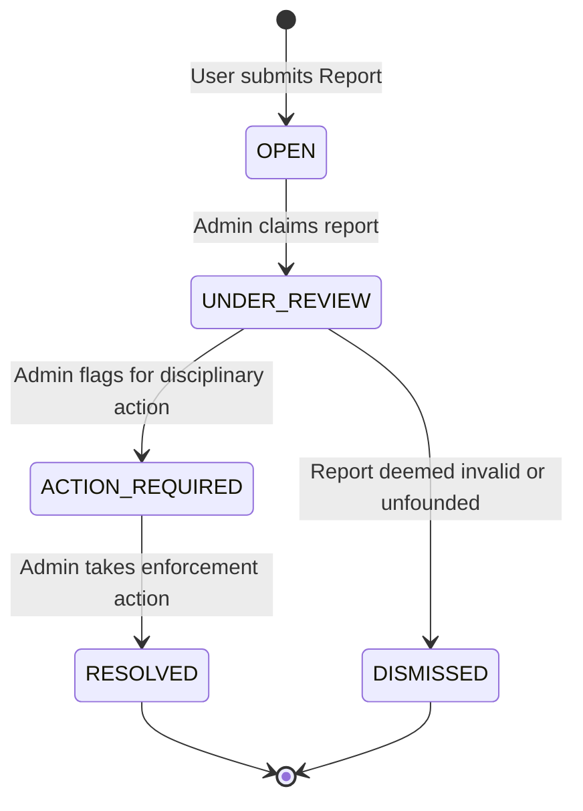
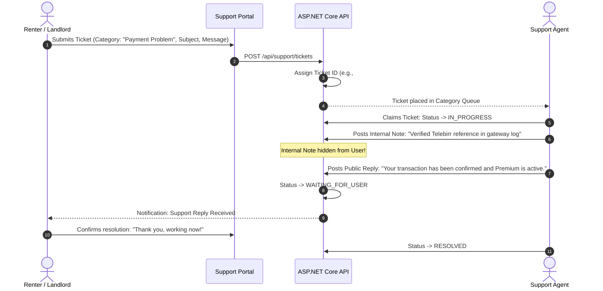

# ETrental: Admin and Support Operations

**Project Name:** ETrental — Online Rental Property Marketplace  
**Target Market:** Ethiopia (Prices in Ethiopian Birr — ETB)  
**Document Reference:** `ETrental_Admin_and_Support_Operations.md`  
**Version:** 1.0.0-PROPOSAL  
**Author:** Pair Programming Agentic Assistant  
**Date:** October 2026  

---

## 1. Platform Governance & Administration Overview

The Administrative and Support portals are designed to operate, govern, and maintain the ETrental marketplace. Platform integrity, anti-fraud enforcement, and user dispute mediation are paramount to preventing rental scams in fast-growing urban centers like Addis Ababa.

```
+-----------------------------------------------------------------------------------------+
|  [ ETrental Admin Governance Portal ]                 [Admin: Super Administrator]      |
+-----------------------------------------------------------------------------------------+
|  ADMIN NAV          |  PLATFORM HEALTH DASHBOARD                                        |
|  [ Platform KPIs ]  |  +----------------+  +----------------+  +----------------+       |
|  [ Listing Moderation]| Total Users     |  | Total Properties| | Pending Reviews |       |
|  [ User Management ]|     4,250        |  |     1,820      |  |    14 Listings  |       |
|  [ Agency Approvals]|  +----------------+  +----------------+  +----------------+       |
|  [ Reports/Trust ]  |                                                                   |
|  [ Support Tickets ]|  URGENT MODERATION QUEUE                                          |
|  [ Audit Logs ]     |  • Listing #1402: "Furnished G+1 Villa in Bole" (Submitted 1h ago)|
|  [ System Settings ]|  • Agency #45: "Habesha Realty PLC" (Awaiting TIN Verification)   |
|                     |  • User Report #89: Suspicious advance payment request in CMC     |
+-----------------------------------------------------------------------------------------+
```

---

## 2. Listing Moderation Subsystem

Every newly submitted property listing or significant price/description edit enters the `PENDING_REVIEW` queue before becoming visible in public search queries.



### 2.1 Rejection Categories & Enforcement Rules
When rejecting a listing, the administrator selects from standardized policy categories:
1. **Unrealistic Pricing / ETB Currency Misrepresentation:** Listing prices that are suspiciously low (e.g., a luxury Bole villa listed for 2,000 ETB/mo — common deposit scam pattern).
2. **Substandard or Watermarked Photographs:** Blurry photos, screenshots containing third-party broker watermarks, or images with external phone numbers stamped on the picture.
3. **Inaccurate / Misleading Location:** Selecting Bole Sub-city when the property description notes it is in Akaki or outside Addis Ababa.
4. **Duplicate Listing:** Multiple identical listings posted by competing brokers for the same physical property.
5. **Prohibited Commercial Solicitation:** Unrelated business services advertised within residential rental fields.

---

## 3. Trust, Safety & User Reports Investigation

Renters and landlords can flag listings, messages, or accounts for policy violations. Reports are processed through a structured investigation pipeline:



### 3.1 Enforcement Actions
- **Issue Formal Warning:** Automated email and portal banner notifying the user of the violation.
- **Unpublish & Lock Listing:** Immediately revokes public visibility and prevents re-editing pending verification.
- **Temporary Suspension (7–30 Days):** Suspends login and listing capabilities.
- **Permanent Account Ban:** Blacklists user email, phone number, and national ID reference.

---

## 4. Customer Support Ticketing System

The support desk addresses technical difficulties, account access issues, verification appeals, and billing questions.



### 4.1 Separation of Public Messages vs Internal Notes
- **Public Message:** Visible to the submitting user and all support agents.
- **Internal Note:** Marked with `IsInternalNote = true`. Strictly restricted to Support and Admin roles. Used for fraud investigation observations, gateway transaction references, or manager escalations.
- **Security Invariant:** Support staff can **never** view plain-text user passwords or bypass multi-factor authentication.

---

## 5. Platform Configuration & Master Catalogs

Platform administrators configure core business parameters via `/admin/settings`:
1. **Ethiopian Geographic Catalog:** Manage supported Regions, Cities, Sub-Cities, and landmark tags.
2. **Taxonomy & Amenities:** Add or retire amenity types (e.g., adding "Electric Vehicle Charger" or "Fiber Internet").
3. **Subscription Tier Configurations:**
   - Free Tier: Max 5 active favorites, 3 inquiries/week, standard search.
   - Premium Tier: Unlimited favorites, unlimited inquiries, instant alert notifications, landlord direct phone access.
   - Configurable monthly price in ETB (e.g., 299 ETB / month).
4. **Maintenance Mode:** Ability to place the platform into read-only mode during major scheduled updates.

---

## 6. Audit Logging & Compliance

To guarantee non-repudiation and regulatory compliance, all sensitive administrative actions are logged to an immutable `AuditLogs` table:

| Field Name | Type | Description |
|---|---|---|
| `Id` | `Guid` | Unique audit entry identifier |
| `Timestamp` | `DateTimeOffset` | Precise UTC timestamp of the operation |
| `UserId` | `string` | ID of the administrator or support agent |
| `UserEmail` | `string` | Email of the acting administrator |
| `Action` | `string` | e.g., `ListingApproved`, `ListingRejected`, `UserSuspended`, `SettingModified` |
| `EntityName` | `string` | Target entity: `Property`, `User`, `Agency`, `PlatformSetting` |
| `EntityId` | `string` | Primary key identifier of the affected record |
| `IpAddress` | `string` | Originating client IP address |
| `OldValues` | `nvarchar(max)` | JSON serialization of state prior to change |
| `NewValues` | `nvarchar(max)` | JSON serialization of state after change |
| `Reason` | `string` | Required operator explanation for manual interventions |
