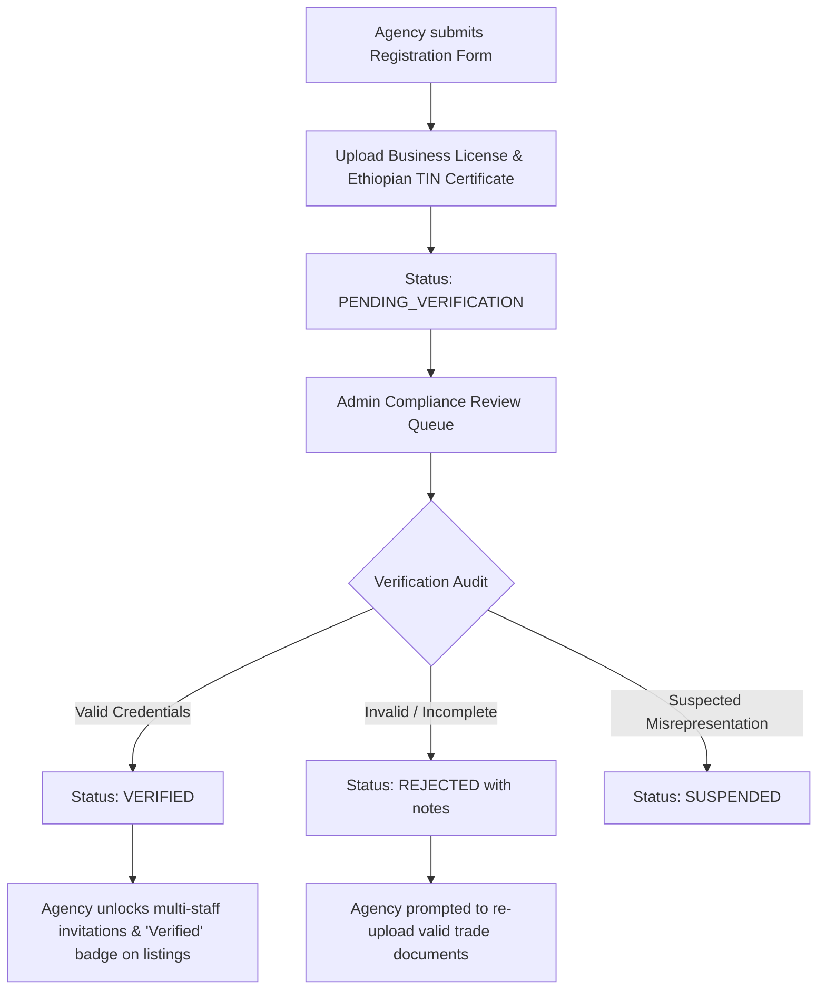
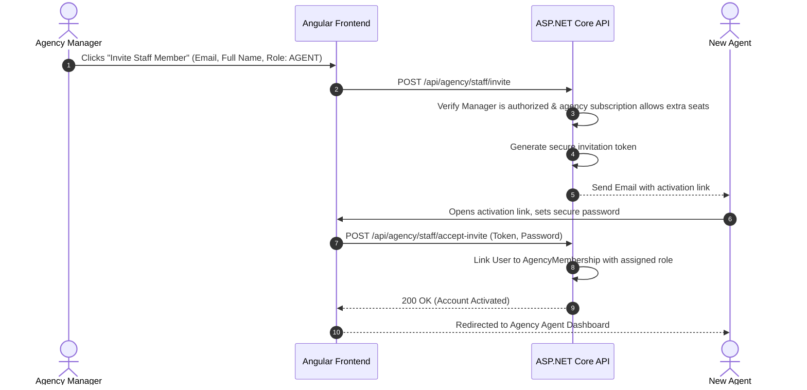
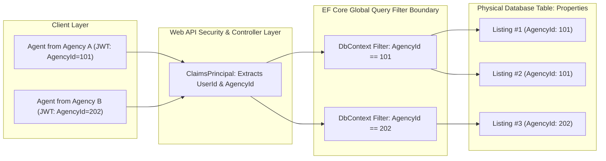

# ETrental: Agency Management Specification

**Project Name:** ETrental — Online Rental Property Marketplace  
**Target Market:** Ethiopia (Prices in Ethiopian Birr — ETB)  
**Document Reference:** `ETrental_Agency_Management_Specification.md`  
**Version:** 1.0.0-PROPOSAL  
**Author:** Pair Programming Agentic Assistant  
**Date:** October 2026  

---

## 1. Agency Multi-Tenancy Architecture

In the Ethiopian rental ecosystem, licensed real estate agencies and brokers (*Delalas / Real Estate Agencies*) manage large portfolios of commercial and residential properties across urban hubs. 

ETrental incorporates dedicated **Corporate Agency Multi-Tenancy**. An agency acts as a container organization with its own branding, verified credentials, staff hierarchy, shared property catalog, and delegated inquiries.

```
+-----------------------------------------------------------------------------------------+
|  [ ETrental Agency Hub ]       Agency: "Abyssinia Property Management"  [Verified Agency] |
+-----------------------------------------------------------------------------------------+
|  AGENCY NAVIGATION    |  AGENCY PORTFOLIO OVERVIEW                                      |
|  [ Dashboard ]        |  +----------------+  +----------------+  +----------------+     |
|  [ Agency Properties] |  | Active Listings|  | Assigned Staff |  | New Inquiries  |     |
|  [ Staff Members (4)] |  |       28       |  |   4 Agents     |  |   12 Unread    |     |
|  [ Inquiries & Leads] |  +----------------+  +----------------+  +----------------+     |
|  [ Viewings Schedule] |                                                                 |
|  [ Performance/Stats] |  STAFF DIRECTORY & WORKLOAD                                     |
|  [ Agency Profile ]   |  • Almaz Kebede   | Role: Agent   | Assigned: 8 Listings  | Act |
|  [ Subscription ]     |  • Dawit Tadesse  | Role: Agent   | Assigned: 12 Listings | Act |
|                       |  • Helen Bekele   | Role: Viewer  | Assigned: -           | Act |
+-----------------------------------------------------------------------------------------+
```

---

## 2. Agency Registration & Verification Workflow

To safeguard renters against unlicensed brokers and property fraud, corporate agencies undergo rigorous administrative verification:



### 2.1 Agency Profile Fields
- **Commercial Name:** e.g., "Addis Prime Real Estate & Rental PLC".
- **Ethiopian Tax Identification Number (TIN):** 10-digit formal TIN.
- **Trade License / Registration Number:** Issued by the Ethiopian Ministry of Trade & Industry.
- **Physical Head Office Location:** City (e.g., Addis Ababa), Sub-city (e.g., Bole, Kirkos), Building, Floor/Office number.
- **Official Contact Phone & Email:** Verified corporate contact channels.
- **Company Logo & Profile Banner:** Branded assets displayed on all agency property pages.

---

## 3. Agency Staff Hierarchy & Internal Permissions

An agency can invite multiple employees and assign specific organizational roles:

| Agency Internal Role | Permissions & Responsibilities | Restrictions |
|---|---|---|
| **`AGENCY_OWNER` / `AGENCY_MANAGER`** | Full control over agency account; invite/deactivate staff; assign listings; manage billing; view all company financials and reports. | Cannot access other agencies' data; cannot bypass platform listing moderation. |
| **`AGENT` (Property Manager)** | Create and edit assigned properties; view and respond to inquiries on assigned listings; conduct viewings; review tenant applications. | Cannot invite/remove staff; cannot access properties assigned to peer agents unless granted company-wide access. |
| **`AGENCY_STAFF` / `VIEWER`** | Read-only access to agency listings, viewing schedules, and client contact information. | Cannot create listings, edit terms, or approve rental applications. |



---

## 4. Multi-Tenancy Data Isolation & Security Boundary

Data isolation is a primary architectural requirement. An agency must **never** be permitted to view, query, or mutate listings, inquiries, or applicant data belonging to any other agency or private landlord.



### 4.1 Implementation Mechanism
1. **Claims Principal Injection:** Upon JWT validation, the `CurrentUserService` resolves the user's `AgencyId` and `AgencyRole`.
2. **EF Core Global Query Filters:** In `ApplicationDbContext.cs`, queries on agency-owned entities apply:
   ```csharp
   builder.Entity<Property>()
       .HasQueryFilter(p => _currentUserService.IsAdmin || p.AgencyId == _currentUserService.AgencyId);
   ```
3. **Application Handler Authorization:** Every command (e.g., `UpdateAgencyPropertyCommand`, `AssignStaffCommand`) explicitly checks that the target resource's `AgencyId` matches the authenticated caller's claims.

---

## 5. Property Portfolio Assignment & Performance Analytics

### 5.1 Listing Delegation
An Agency Manager can delegate properties to specific staff members:
- **Primary Assigned Agent:** The designated contact person whose name and phone number appear on the property detail card.
- **Reassignment:** If an agent leaves or is on leave, the manager can reassign their active properties and incoming inquiries with a single click.

### 5.2 Agency Performance Reporting
The agency dashboard includes built-in operational intelligence:
- **Portfolio Vacancy Rate:** Percentage of properties currently `Published` vs `Rented`.
- **Inquiry Response Velocity:** Average time taken by each agent to reply to renter queries.
- **Conversion Ratio:** Total inquiries $\rightarrow$ Scheduled Viewings $\rightarrow$ Executed Tenancy Agreements.
- **Export Capabilities:** CSV/Excel export of monthly rental activity for agency tax and internal accounting.
