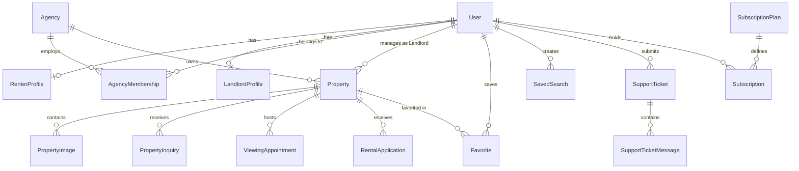

# ETrental: Functional & Non-Functional Requirements Specification

**Project Name:** ETrental — Online Rental Property Marketplace  
**Target Market:** Ethiopia (Prices in Ethiopian Birr — ETB)  
**Document Reference:** `ETrental_Functional_NonFunctional_Requirements.md`  
**Version:** 1.0.0-PROPOSAL  
**Author:** Pair Programming Agentic Assistant  
**Date:** October 2026  

---

## 1. Functional Requirements (FR) Catalog

Each requirement is uniquely identified, categorized, prioritized, and linked to its business domain.

### 1.1 Authentication & Role-Based Access Control (FR-AUTH)

| ID | Feature Name | Role | Priority | Description & Acceptance Criteria |
|---|---|---|---|---|
| **FR-AUTH-001** | User Registration | All | Critical | Users can register as Renter, Landlord, or Agency. Inputs (Email, Phone, Password) must be validated. Passwords must require min 8 chars, 1 uppercase, 1 digit, 1 special char. |
| **FR-AUTH-002** | Secure JWT Login | All | Critical | Authentication issues cryptographically signed JWT tokens with claims (UserId, Email, Roles, AgencyId) and HttpOnly refresh tokens. |
| **FR-AUTH-003** | Password Recovery | All | High | Users can request a secure, time-limited (15-minute) password reset token delivered via email. |
| **FR-AUTH-004** | Role Separation Guard | All | Critical | Server-side authorization attributes (`[Authorize(Roles = "...")]`) strictly guard endpoints. Unauthorized requests return HTTP 403 Forbidden. |
| **FR-AUTH-005** | Ethiopian Phone Format | All | Medium | System validates local phone numbers starting with `+2519...` or `+2517...` (Safaricom / Ethio Telecom). |

### 1.2 Property Discovery & Search Engine (FR-SRCH)

| ID | Feature Name | Role | Priority | Description & Acceptance Criteria |
|---|---|---|---|---|
| **FR-SRCH-001** | Location Filtering | Public / Renter | Critical | Filter properties by Ethiopian Region, City, Sub-City (e.g., Bole, Yeka, Hawassa), and specific neighborhood. |
| **FR-SRCH-002** | Budget & ETB Price Range | Public / Renter | Critical | Filter by minimum and maximum monthly rental amounts in ETB with range sliders and input boxes. |
| **FR-SRCH-003** | Room & Size Filtering | Public / Renter | High | Filter by bedroom counts (Studio, 1, 2, 3, 4+), bathroom counts, and floor area ($m^2$). |
| **FR-SRCH-004** | Ethiopian Amenity Filter | Public / Renter | High | Filter listings having Reserve Water Tank (*Rotto*), Backup Generator, Guard House, Elevator, Parking, or Wi-Fi. |
| **FR-SRCH-005** | Pagination & Sorting | Public / Renter | High | Paginate results (default 12 items/page). Sort by `Newest`, `Price: Low to High`, `Price: High to Low`. |
| **FR-SRCH-006** | Published-Only Enforcement | Public / Renter | Critical | Search endpoints exclusively return listings where `Status == PUBLISHED`. Draft, Pending, or Rejected listings are never exposed. |

### 1.3 Renter Features & Interactions (FR-RENT)

| ID | Feature Name | Role | Priority | Description & Acceptance Criteria |
|---|---|---|---|---|
| **FR-RENT-001** | Save Favorite Properties | Renter | High | Renters can toggle favorites on listings. System enforces configured Free/Premium limit (Free: 5 items max). |
| **FR-RENT-002** | Saved Searches & Alerts | Renter | Medium | Renters can save search filter combinations and receive alerts when new matching listings are published. |
| **FR-RENT-003** | Direct Listing Inquiries | Renter | High | Renters can send direct questions to listing owners through the in-app message hub. |
| **FR-RENT-004** | Viewing Appointment Booking | Renter | High | Renters can request physical viewing timeslots; receive confirmations, reschedule proposals, or cancellations. |
| **FR-RENT-005** | Digital Rental Application | Renter | High | Renters can submit structured tenancy applications detailing move-in date, lease length, and occupant count. |
| **FR-RENT-006** | Listing Fraud Reporting | Renter | Medium | Renters can flag suspicious or duplicate listings with custom comments for administrative review. |

### 1.4 Landlord Property Operations (FR-LL)

| ID | Feature Name | Role | Priority | Description & Acceptance Criteria |
|---|---|---|---|---|
| **FR-LL-001** | Multi-Step Add Property | Landlord | Critical | Guided 6-step form capturing title, type, Ethiopian location, ETB pricing, advance months, amenities, and photos. |
| **FR-LL-002** | Secure Photo Upload | Landlord | Critical | Upload 3 to 20 photos. Validates image MIME types (`image/jpeg`, `image/png`, `image/webp`) and enforces 5MB limit. |
| **FR-LL-003** | Draft & Submit Review | Landlord | Critical | Landlord can save unfinished listings as `DRAFT` or submit to `PENDING_REVIEW` for admin approval. |
| **FR-LL-004** | Availability Toggling | Landlord | High | Landlords can toggle published listings between `PUBLISHED` and `UNAVAILABLE` without losing data. |
| **FR-LL-005** | Inquiry Messaging Response | Landlord | High | Landlords can view incoming renter inquiries and send conversational replies. |
| **FR-LL-006** | Viewing Calendar Management | Landlord | High | Accept, reject, or propose alternative timeslots for requested viewing appointments. |
| **FR-LL-007** | Mark as Rented | Landlord | High | Landlord records completed tenancy terms, transitioning listing to `RENTED` and closing pending applications. |

### 1.5 Agency Multi-Tenancy Management (FR-AGY)

| ID | Feature Name | Role | Priority | Description & Acceptance Criteria |
|---|---|---|---|---|
| **FR-AGY-001** | Agency Profile & TIN | Agency | Critical | Register agency company profile including legal trade name, Ethiopian TIN, business license, and office address. |
| **FR-AGY-002** | Staff Invitation & RBAC | Agency | High | Invite employees as `AGENCY_MANAGER`, `AGENT`, or `VIEWER` via secure tokenized email links. |
| **FR-AGY-003** | Property Delegation | Agency | High | Assign properties to specific agents; manage assigned inquiries and client communication. |
| **FR-AGY-004** | Strict Tenant Isolation | Agency | Critical | Agency members can strictly access only properties, inquiries, and records belonging to their `AgencyId`. |
| **FR-AGY-005** | Agency Performance Report | Agency | Medium | View operational analytics: active inventory, vacancy rates, average agent inquiry response times. |

### 1.6 Moderation & Administration (FR-ADM)

| ID | Feature Name | Role | Priority | Description & Acceptance Criteria |
|---|---|---|---|---|
| **FR-ADM-001** | Listing Moderation Queue | Admin | Critical | Review all `PENDING_REVIEW` listings with actions to `Approve`, `Reject` (with reason category), or `Request Correction`. |
| **FR-ADM-002** | Agency Verification Review | Admin | High | Audit uploaded business licenses and TINs to transition agency accounts from `PENDING` to `VERIFIED` or `REJECTED`. |
| **FR-ADM-003** | User Account Governance | Admin | High | Search accounts, review activity, and apply temporary suspensions or permanent bans for policy violations. |
| **FR-ADM-004** | Trust & Safety Resolution | Admin | High | Manage reported listings/users with status tracking (`OPEN`, `UNDER_REVIEW`, `ACTION_REQUIRED`, `RESOLVED`). |
| **FR-ADM-005** | Master Catalog Management | Admin | Medium | Add/modify supported Ethiopian regions, cities, sub-cities, and amenity catalog items. |
| **FR-ADM-006** | Immutable Audit Trail | Admin | Critical | Automatically record all administrative decisions with timestamp, operator ID, target entity, and change delta. |

### 1.7 Customer Support Operations (FR-SUP)

| ID | Feature Name | Role | Priority | Description & Acceptance Criteria |
|---|---|---|---|---|
| **FR-SUP-001** | Ticket Submission | Renter / Landlord | High | Submit support tickets with categories (Account, Listing, Billing, Fraud, Technical) and priority. |
| **FR-SUP-002** | Support Desk Management | Support / Admin | High | Filter tickets by status, category, and priority. Assign tickets to specific support agents. |
| **FR-SUP-003** | Internal Private Notes | Support / Admin | High | Add internal notes on tickets visible only to staff, keeping internal investigations confidential from users. |
| **FR-SUP-004** | Ticket Status Workflow | Support / Admin | High | Transition tickets through `OPEN`, `IN_PROGRESS`, `WAITING_FOR_USER`, `ESCALATED`, and `RESOLVED`. |

### 1.8 Subscription & Payment Operations (FR-SUB)

| ID | Feature Name | Role | Priority | Description & Acceptance Criteria |
|---|---|---|---|---|
| **FR-SUB-001** | Plan Catalog Display | Public / Renter | High | Present transparent comparison of Free vs Premium tiers with prices in ETB and distinct entitlement limits. |
| **FR-SUB-002** | Upgrade Checkout Workflow | Renter | High | Initiate upgrade with selected billing cycle (Monthly, Quarterly, Annual) and prepared Ethiopian payment gateway. |
| **FR-SUB-003** | Server-Side Entitlement | System | Critical | Entitlements (e.g., unlimited favorites, direct landlord phone access) strictly enforced on backend APIs. |
| **FR-SUB-004** | Subscription Status Cycle | System | Critical | Automatically manage statuses: `FREE`, `ACTIVE`, `EXPIRED`, `CANCELLED` without deleting user history. |

---

## 2. Non-Functional Requirements (NFR)

### 2.1 Security & Privacy (NFR-SEC)
- **NFR-SEC-001 (Zero-Trust Authorization):** Every mutation endpoint enforces resource ownership validation. A landlord cannot edit properties where `property.LandlordId != currentUserId`.
- **NFR-SEC-002 (Credential Hashing):** Passwords hashed using ASP.NET Core Identity's PBKDF2 with HMAC-SHA256 and unique per-user salt.
- **NFR-SEC-003 (File Upload Sanitization):** Uploaded images stripped of EXIF metadata, scanned for executable byte headers, and stored under non-guessable GUID filenames.
- **NFR-SEC-004 (JWT Cryptography):** Access tokens signed using HMAC-SHA512 with a minimum 256-bit secret key; expiration strictly capped at 60 minutes.
- **NFR-SEC-005 (Tenant Boundary):** Agency multi-tenancy enforced using EF Core Global Query Filters preventing cross-tenant leakage.

### 2.2 Performance & Scalability (NFR-PERF)
- **NFR-PERF-001 (API Latency):** 95th percentile response time for public property search endpoints $\le 250\text{ ms}$ under 50 concurrent requests.
- **NFR-PERF-002 (Database Indexing):** Composite database indexes applied on:
  - `(Status, City, SubCity, RentAmountETB)`
  - `(LandlordId, Status)`
  - `(AgencyId, Status)`
- **NFR-PERF-003 (Payload Optimization):** Image uploads compressed to modern WebP format where feasible with max dimensions $1920 \times 1080\text{ px}$.

### 2.3 Reliability & Maintainability (NFR-REL)
- **NFR-REL-001 (Clean Architecture Isolation):** Zero circular dependencies. Presentation and Infrastructure reference Application; Application references only Domain; Domain references no other project.
- **NFR-REL-002 (Graceful Error Handling):** All unhandled server exceptions caught by global middleware, returning standard RFC 7807 `ProblemDetails` JSON without leaking call stacks.
- **NFR-REL-003 (Soft Deletion):** Properties, accounts, and inquiries support soft deletion (`IsDeleted`, `DeletedAtUtc`) to preserve legal and financial audit integrity.

### 2.4 Usability & Ethiopian Context (NFR-LOC)
- **NFR-LOC-001 (Currency Fidelity):** All currency displays and calculations use Ethiopian Birr (`ETB`) with consistent two-decimal-place rounding.
- **NFR-LOC-002 (Mobile-First Responsiveness):** Full UI accessibility and touch responsiveness across screen widths down to 320px, optimizing for mobile data conditions in Ethiopia.
- **NFR-LOC-003 (i18n Readiness):** Architecture prepared for multi-lingual localization (English, Amharic, Afaan Oromo) via resource strings and JSON translation files.

---

## 3. Database Entity Specifications (EF Core)

Below is the definitive relational data model to be implemented in `ETrental.Domain` and configured in `ETrental.Infrastructure.Persistence.ApplicationDbContext`:



### 3.1 Primary Entity Fields & Types

```csharp
// Domain/Entities/Property.cs
public class Property : AuditableEntity
{
    public Guid Id { get; set; }
    public string Title { get; set; } = string.Empty;
    public string Description { get; set; } = string.Empty;
    public PropertyType PropertyType { get; set; }
    public PropertyStatus Status { get; set; } = PropertyStatus.Draft;
    
    // Ethiopian Location
    public string Region { get; set; } = string.Empty;
    public string City { get; set; } = string.Empty;
    public string SubCity { get; set; } = string.Empty;
    public string Neighborhood { get; set; } = string.Empty;
    public string? Landmark { get; set; }
    public double? Latitude { get; set; }
    public double? Longitude { get; set; }

    // Financials in ETB
    public decimal RentAmountETB { get; set; }
    public decimal DepositAmountETB { get; set; }
    public int AdvanceMonthsRequired { get; set; } = 3;
    public int MinimumLeaseMonths { get; set; } = 6;
    public DateTime AvailableFromDate { get; set; }

    // Specifications & Amenities
    public int Bedrooms { get; set; }
    public int Bathrooms { get; set; }
    public double? AreaSquareMeters { get; set; }
    public FurnishingStatus Furnishing { get; set; }
    public bool HasWaterTank { get; set; }
    public bool HasGenerator { get; set; }
    public bool HasSecurityGuard { get; set; }
    public bool HasParking { get; set; }
    public bool HasElevator { get; set; }
    public bool HasWifi { get; set; }

    // Ownership & Foreign Keys
    public string LandlordId { get; set; } = string.Empty;
    public User Landlord { get; set; } = null!;
    public Guid? AgencyId { get; set; }
    public Agency? Agency { get; set; }
    public string? AssignedAgentId { get; set; }
    public User? AssignedAgent { get; set; }

    // Navigation Collections
    public ICollection<PropertyImage> Images { get; set; } = new List<PropertyImage>();
    public ICollection<PropertyInquiry> Inquiries { get; set; } = new List<PropertyInquiry>();
    public ICollection<ViewingAppointment> Appointments { get; set; } = new List<ViewingAppointment>();
    public ICollection<RentalApplication> Applications { get; set; } = new List<RentalApplication>();
}
```

---

## 4. Free vs Premium Subscription Matrix

| Marketplace Capability | Free Tier | Premium Tier |
|---|---|---|
| Browse & Search Public Listings | Unlimited | Unlimited |
| Save Favorite Properties | Up to 5 listings | Unlimited listings |
| Saved Search Alerts | 1 saved search (Daily digest) | Up to 10 saved searches (Instant email alerts) |
| Direct Landlord Inquiries | Up to 3 per calendar week | Unlimited instant inquiries |
| Landlord Direct Phone Number | Masked / Portal messaging only | Direct phone call & WhatsApp unlock |
| Viewing Appointment Priority | Standard queue | High-priority flag shown to landlord |
| Rental Application Badge | Standard applicant badge | "Verified Renter" verified profile badge |
| Price per Month | 0 ETB / month | Configurable (e.g., 299 ETB / month) |
