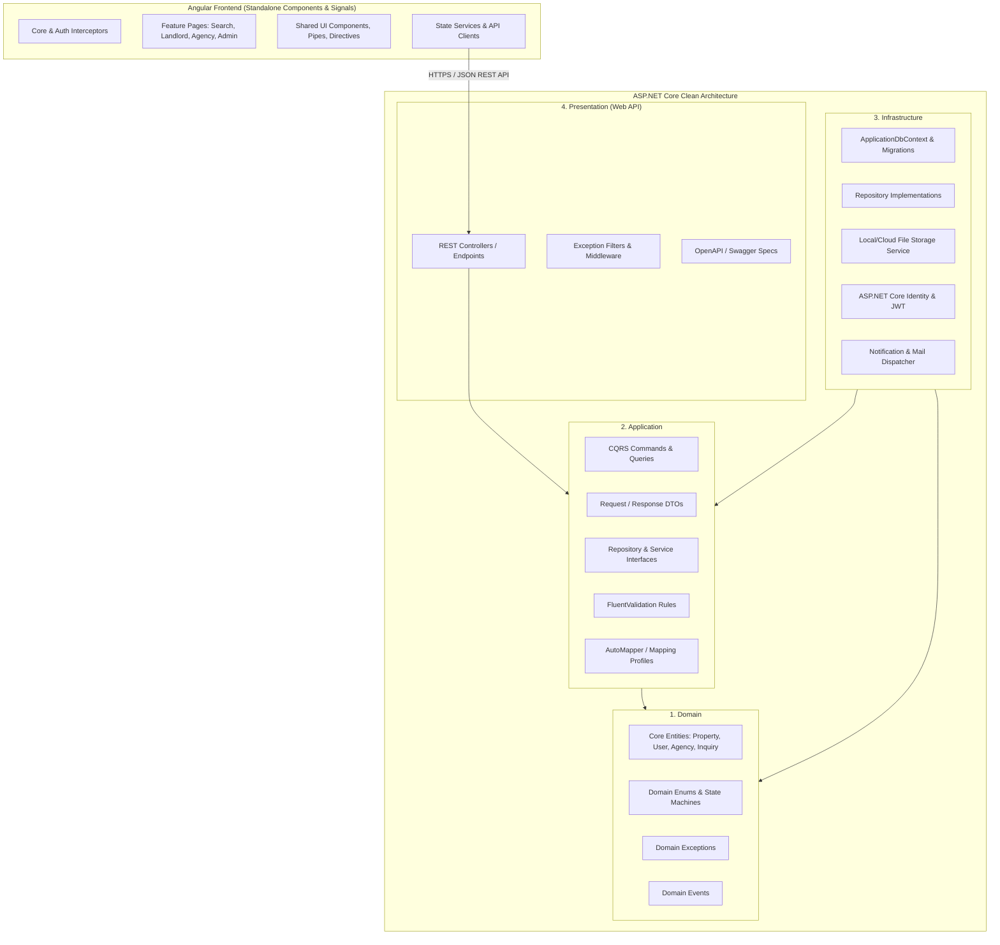

# ETrental: Project Assessment and Gap Analysis

**Project Name:** ETrental — Online Rental Property Marketplace  
**Target Market:** Ethiopia (Prices in Ethiopian Birr — ETB)  
**Reference Website:** Rentola (`https://rentola.com.br`)  
**Technology Stack:** ASP.NET Core Clean Architecture (Backend) + Angular Standalone / Signals (Frontend)  
**Document Reference:** `ETrental_Project_Assessment_and_Gap_Analysis.md`  
**Version:** 1.0.0-PROPOSAL  
**Author:** Pair Programming Agentic Assistant  
**Date:** October 2026  

---

## 1. Executive Summary & Project Context

### 1.1 Project Purpose
**ETrental** is a full-featured online rental property marketplace engineered specifically for the Ethiopian real estate ecosystem. It bridges the gap between individual renters, private landlords, licensed real estate agencies, and platform administrators. 

The primary inspiration is modern rental aggregators such as Rentola, adapted directly for Ethiopian urban centers (such as Addis Ababa, Hawassa, Bahir Dar, Adama, Mekelle, and Dire Dawa), accommodating local tenancy traditions, currency (`ETB`), deposit conventions, and communication workflows.

### 1.2 Inspection Summary
An initial architectural inspection of the workspace root (`c:\Users\moon\OneDrive\Desktop\ETrental`) reveals:
1. Two primary target directories exist: `backend/` and `frontend/`.
2. Both folders are currently clean/unscaffolded directories prepared for the new final-year capstone project implementation.
3. The host environment provides modern, production-ready toolchains:
   - **.NET SDK:** `10.0.302` (supporting C# 13/12, ASP.NET Core Web API, Entity Framework Core)
   - **Node.js:** `v22.18.0` with **npm:** `10.9.3`
   - **Angular CLI:** `21.2.24` (supporting latest Angular standalone components, Signals, control flow `@if` / `@for`, typed forms, and modern SSR/client routing)

In compliance with the mandatory working rules, **no source code has been altered, no packages have been installed, and no database commands have been run.** This document constitutes the definitive architectural assessment, gap analysis, and technology blueprint awaiting explicit user authorization.

---

## 2. Architectural Blueprint & Project Structure

The project will strictly follow a decoupled **Clean Architecture (Onion/Hexagonal)** on the backend and a **Modular Standalone Component Architecture** on the frontend.



---

## 3. Directory & Folder Architecture Plan

### 3.1 Backend Clean Architecture Solution (`backend/`)
Following the user's explicit requirement, the backend source is organized into four distinct Clean Architecture projects under `backend/src/`:

```
backend/
├── ETrental.sln
└── src/
    ├── ETrental.Domain/                      # Layer 1: Core Domain Rules & Entities
    │   ├── Common/                           # BaseEntity, AuditableEntity, ValueObject
    │   ├── Entities/
    │   │   ├── User.cs                       # Platform user profile & credentials
    │   │   ├── RenterProfile.cs              # Specific renter metadata & preferences
    │   │   ├── LandlordProfile.cs            # Landlord verification & details
    │   │   ├── Agency.cs                     # Corporate agency tenant entity
    │   │   ├── AgencyMembership.cs           # Agency-staff mapping with roles
    │   │   ├── Property.cs                   # Core rental property listing
    │   │   ├── PropertyImage.cs              # Photos, dimensions, cover indicator
    │   │   ├── PropertyAmenity.cs            # Water tank, generator, parking, etc.
    │   │   ├── PropertyInquiry.cs            # Inquiry sent from renter to landlord/agency
    │   │   ├── Conversation.cs               # Messaging thread between renter & host
    │   │   ├── Message.cs                    # Message entity within a conversation
    │   │   ├── ViewingAppointment.cs         # Viewing schedule, status & notes
    │   │   ├── RentalApplication.cs          # Formal rental application & submission
    │   │   ├── RentalAgreement.cs            # Completed tenancy terms & record
    │   │   ├── Favorite.cs                   # Saved property listing
    │   │   ├── SavedSearch.cs                # Saved criteria & alert preference
    │   │   ├── SubscriptionPlan.cs           # Free vs Premium tier configuration
    │   │   ├── Subscription.cs               # Active user subscription record
    │   │   ├── PaymentTransaction.cs         # Audit record of subscription payments
    │   │   ├── SupportTicket.cs              # Customer support ticket
    │   │   ├── SupportTicketMessage.cs       # Ticket response (public or internal note)
    │   │   ├── UserReport.cs                 # Listing / user report for fraud/moderation
    │   │   ├── AuditLog.cs                   # Administrative & security audit trail
    │   │   └── PlatformSetting.cs            # Global platform configurations
    │   ├── Enums/
    │   │   ├── PropertyStatus.cs             # Draft, PendingReview, Approved, Rejected, Published, Unavailable, Rented, Archived
    │   │   ├── PropertyType.cs               # Apartment, Condominium, Villa, GPlusOne, Studio, Commercial, ServiceQuarter
    │   │   ├── UserRole.cs                   # Admin, Support, Landlord, AgencyManager, Agent, Renter
    │   │   ├── AgencyStatus.cs               # Pending, Verified, Rejected, Suspended
    │   │   ├── AppointmentStatus.cs          # Requested, Confirmed, Rescheduled, Cancelled, Completed
    │   │   ├── ApplicationStatus.cs          # Submitted, UnderReview, Accepted, Rejected, Withdrawn
    │   │   ├── TicketStatus.cs               # Open, InProgress, WaitingForUser, Escalated, Resolved
    │   │   ├── ReportStatus.cs               # Open, UnderReview, ActionRequired, Resolved, Dismissed
    │   │   └── SubscriptionStatus.cs         # Free, PendingPayment, Active, Expired, Cancelled
    │   └── Exceptions/                       # Domain-level exception definitions
    │
    ├── ETrental.Application/                 # Layer 2: Use Cases & Business Operations
    │   ├── Common/
    │   │   ├── Interfaces/                   # IApplicationDbContext, ICurrentUserService, IFileStorageService
    │   │   ├── Models/                       # PaginatedList<T>, Result<T>
    │   │   └── Behaviors/                    # ValidationBehavior, LoggingBehavior
    │   ├── Features/
    │   │   ├── Auth/                         # LoginCommand, RegisterCommand, RefreshToken
    │   │   ├── Properties/                   # CreatePropertyCommand, UpdatePropertyCommand, GetPropertiesQuery
    │   │   ├── Inquiries/                    # CreateInquiryCommand, GetInquiriesQuery
    │   │   ├── Appointments/                 # BookAppointmentCommand, UpdateAppointmentStatus
    │   │   ├── Applications/                 # SubmitApplicationCommand, ProcessApplicationCommand
    │   │   ├── Agencies/                     # RegisterAgencyCommand, InviteStaffCommand
    │   │   ├── Moderation/                   # ReviewListingCommand, ModerateReportCommand
    │   │   ├── Support/                      # CreateTicketCommand, AddTicketReplyCommand
    │   │   └── Subscriptions/                # SubscribePlanCommand, VerifyPaymentCommand
    │   └── DTOs/                             # Strongly-typed data transfer objects
    │
    ├── ETrental.Infrastructure/              # Layer 3: Database Access & External Services
    │   ├── Persistence/
    │   │   ├── ApplicationDbContext.cs       # EF Core DbContext with model configurations
    │   │   ├── Configurations/               # EntityTypeConfigurations (Fluent API mappings)
    │   │   ├── Migrations/                   # EF Core database migrations
    │   │   └── Seeders/                      # Initial data: Ethiopian locations, roles, default admin
    │   ├── Services/
    │   │   ├── LocalFileStorageService.cs    # Image upload, validation & thumbnail generation
    │   │   ├── JwtTokenGenerator.cs          # Secure JWT creation with claims & roles
    │   │   ├── CurrentUserService.cs         # HttpContextAccessor wrapper extracting ClaimsPrincipal
    │   │   └── DateTimeService.cs            # IDateTime provider (UTC/Local Ethiopian time)
    │   └── Repositories/                     # Specific repository implementations if needed
    │
    └── ETrental.Presentation/                # Layer 4: Web API & HTTP Endpoints
        ├── Controllers/
        │   ├── AuthController.cs             # POST /api/auth/register, login, refresh
        │   ├── PropertiesController.cs       # GET/POST/PUT /api/properties
        │   ├── RenterController.cs           # Favorites, saved searches, inquiries
        │   ├── LandlordController.cs         # Landlord listings, analytics, tenancy
        │   ├── AgencyController.cs           # Agency profile, staff, delegated listings
        │   ├── AdminController.cs            # Moderation, user controls, configuration
        │   ├── SupportController.cs          # Tickets, agent responses, internal notes
        │   └── SubscriptionsController.cs    # Tier browsing, activation, verification
        ├── Middlewares/
        │   ├── ExceptionHandlingMiddleware.cs
        │   └── SecurityHeadersMiddleware.cs
        ├── Program.cs                        # WebApplication bootstrapping & DI registration
        └── appsettings.json                  # Connection strings, JWT settings, limits
```

### 3.2 Frontend Angular Architecture (`frontend/`)
Scaffolded with the latest Angular CLI (v21/standalone mode), the frontend utilizes signals, lazy-loaded routing, typed forms, and responsive CSS (using Tailwind CSS or modern CSS custom properties):

```
frontend/
├── src/
│   ├── app/
│   │   ├── core/                             # Singleton services, interceptors, guards
│   │   │   ├── guards/                       # auth.guard.ts, role.guard.ts, subscription.guard.ts
│   │   │   ├── interceptors/                 # auth.interceptor.ts, error.interceptor.ts
│   │   │   ├── models/                       # TypeScript interfaces mirroring API DTOs
│   │   │   └── services/                     # auth.service.ts, api.service.ts, notification.service.ts
│   │   ├── shared/                           # Reusable UI widgets
│   │   │   ├── components/                   # property-card, image-carousel, modal, pagination, badge
│   │   │   └── pipes/                        # etb-currency.pipe.ts, time-ago.pipe.ts
│   │   ├── features/                         # Lazy-loaded feature modules / components
│   │   │   ├── public/                       # Landing page, property-detail, search-results
│   │   │   ├── renter/                       # Renter dashboard, favorites, inquiries, applications
│   │   │   ├── landlord/                     # Landlord dashboard, add-property wizard, my-properties
│   │   │   ├── agency/                       # Agency dashboard, staff management, agency-listings
│   │   │   ├── admin/                        # Admin dashboard, moderation queue, user management
│   │   │   ├── support/                      # Support ticket management, ticket-detail
│   │   │   └── subscription/                 # Pricing plans, upgrade workflow, payment status
│   │   ├── app.routes.ts                     # Root routes configuration
│   │   ├── app.config.ts                     # ApplicationConfig (HttpClient, animations, routing)
│   │   └── app.component.ts                  # Root container
│   ├── assets/                               # Static images, Ethiopian location maps, icons
│   └── environments/                         # environment.ts & environment.prod.ts
├── angular.json
├── package.json
└── tsconfig.json
```

---

## 4. Current Repository State & Gap Inventory

Because the workspace currently consists of empty `backend` and `frontend` folders, all functional requirements represent proposed, carefully specified implementations to be created from scratch.

| Feature Area | Current Status | Workspace Evidence | Missing Functionality | Recommended Implementation Action |
|---|---|---|---|---|
| **Solution & Project Setup** | Unscaffolded | `backend/` is empty | ASP.NET Core solution, project files (.csproj), dependencies | Scaffold 4 Clean Architecture projects using `dotnet new` and create `ETrental.sln`. |
| **Frontend Framework** | Unscaffolded | `frontend/` is empty | Angular app, routing, build configuration | Scaffold modern standalone Angular application via `ng new frontend`. |
| **Authentication & RBAC** | Proposed | None | User model, JWT auth, password hashing, role claims | Implement ASP.NET Core Identity with custom `ApplicationUser`, JWT token provider, and Angular `AuthGuard`. |
| **Property Discovery & Search** | Proposed | None | Catalog, search filters (ETB, City, Subcity, Beds, Baths) | Build EF Core filtered queries with paging, indexing on `City`, `SubCity`, `RentAmount`, `Status`. |
| **Add Property & Media** | Proposed | None | Wizard form, file validation, storage, approval status | Implement 6-step property wizard with image size/mime validation and secure local storage. |
| **Listing Moderation** | Proposed | None | Moderation queue, rejection reasons, audit trail | Build admin listing moderation endpoints; ensure unapproved properties are hidden from public queries. |
| **Tenant Inquiries & Chat** | Proposed | None | Inquiries, messaging threads, permissions | Build inquiry entity and landlord reply mechanism with ownership validation. |
| **Viewing Appointments** | Proposed | None | Appointment requests, accept/reject, calendar | Build appointment scheduling system with conflict detection and status updates. |
| **Rental Applications** | Proposed | None | Application forms, document checks, completion | Create rental application workflow transitioning listing from `Published` to `Rented`. |
| **Agency Multi-Tenancy** | Proposed | None | Agency profile, verification, staff RBAC, isolation | Implement `Agency` entity with EF Core global query filters to enforce strict tenant isolation. |
| **Support Operations** | Proposed | None | Tickets, public replies, internal notes | Create support ticket subsystem with role-gated private note visibility. |
| **Subscriptions & Billing** | Proposed | None | Free vs Premium limits, payment verification | Create subscription model; prepare Ethiopian payment integration (Telebirr/Chapa/CBE Birr). |

---

## 5. Ethiopian Rental Market Considerations

To make ETrental a realistic, market-fitting final year project, the specification incorporates the following Ethiopian dynamics:

1. **Currency & Rental Rates:** All rents and deposits are denominated in **Ethiopian Birr (ETB)**. Rental values range from studio/single rooms (~3,000 – 15,000 ETB/mo) to high-end apartments/villas (40,000 – 250,000+ ETB/mo).
2. **Advance Payments & Security Deposits:** In Ethiopia, landlords frequently require 3 to 6 months of advance rent plus 1 to 2 months deposit. The property entity includes explicit fields for `AdvanceMonthsRequired` and `DepositAmountETB`.
3. **Location Hierarchy:** Properties are classified by:
   - **Region / Chartered City:** Addis Ababa, Oromia, Amhara, Sidama, Dire Dawa, Tigray, etc.
   - **City / Sub-City:** e.g., in Addis Ababa: Bole, Yeka, Kirkos, Arada, Nifas Silk-Lafto, Lideta, Kolfe Keranio, Gulele, Akaky Kaliti, Addis Ketema.
   - **Specific Neighborhood / Sefer:** CMC, Kazanchis, Sarbet, Ayat, Old Airport, Piassa, Summit, Meganagna, Gerji, Gotera.
4. **Essential Amenities:** In addition to standard bedrooms/bathrooms, Ethiopian renters prioritize:
   - Reliable Water Supply / Reserve Water Tank (*Rotto*)
   - Backup Electricity Generator
   - 3-Phase Electricity
   - Dedicated Guard / Security Post (*Zegaw*)
   - Compound Parking
   - Traditional Kitchen (*Wetet Bet*)

---

## 6. Critical Security, Privacy & Integrity Risks

| Risk Area | Vulnerability Description | Mitigation in ETrental Architecture |
|---|---|---|
| **IDOR (Insecure Direct Object Reference)** | Attackers modifying URL parameters (e.g., `PUT /api/properties/42`) to edit or delete properties owned by other users. | Every repository query validates `property.LandlordId == currentUserId` or verifies agency staff membership. |
| **Agency Data Leakage** | Agency staff from Agency A querying or viewing inquiries/listings of Agency B. | Tenant isolation enforced at both the database level (EF Core Global Query Filter) and application command handlers. |
| **Client-Side Role Manipulation** | Malicious users sending `role: "Admin"` or `isApproved: true` in registration or listing update payloads. | Strict DTO segregation. Roles are assigned exclusively via server-side identity claims, and listing status transitions are governed by dedicated state machine endpoints. |
| **Unapproved Listing Exposure** | Direct API scraping retrieving properties in `PendingReview`, `Draft`, or `Rejected` states. | Public query handler applies unconditional filter: `p.Status == PropertyStatus.Published`. |
| **Malicious File Uploads** | Uploading PHP/ASPX scripts or oversized payloads masked as JPEG images. | Strict file header verification (magic byte validation), MIME-type whitelisting (`image/jpeg`, `image/png`, `image/webp`), filename sanitization (GUID replacement), and 5MB per-file limits. |
| **Unverified Premium Activation** | Bypassing payment by falsifying redirect callback parameters. | Webhook / server-to-server cryptographic signature verification before activating any subscription entitlement. |

---

## 7. Next Steps & Implementation Prerequisites

Upon receiving the user's explicit confirmation, the project implementation will proceed according to the phased roadmap detailed in Document 7:
1. Scaffold ASP.NET Core Clean Architecture backend with the 4 designated projects.
2. Scaffold Angular standalone frontend with routing and environment configuration.
3. Configure Entity Framework Core with SQL Server / SQLite and initial migrations.
4. Build domain entities and database seeder for Ethiopian locations and administrative roles.
