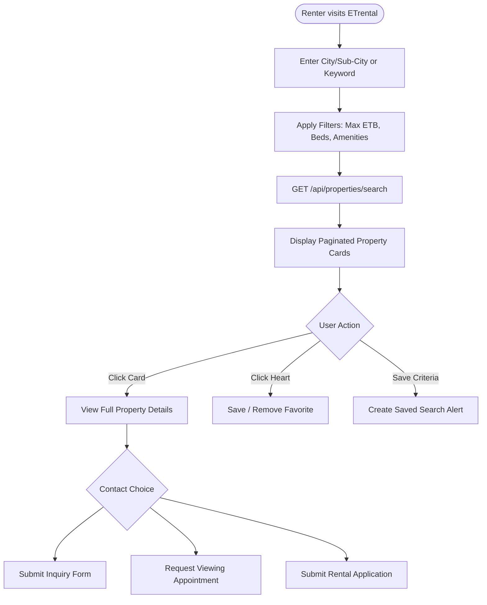
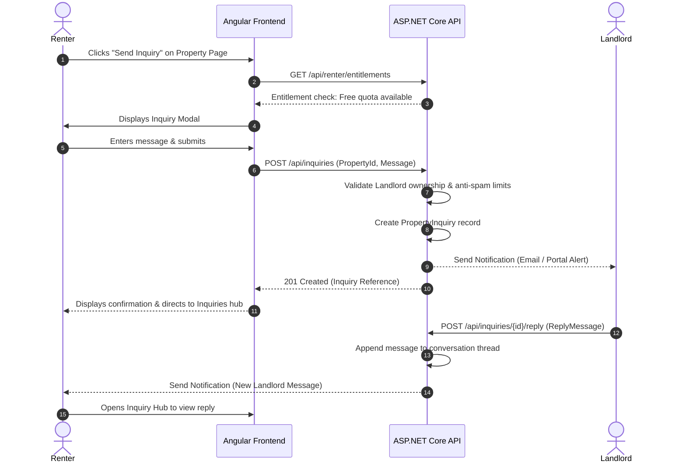
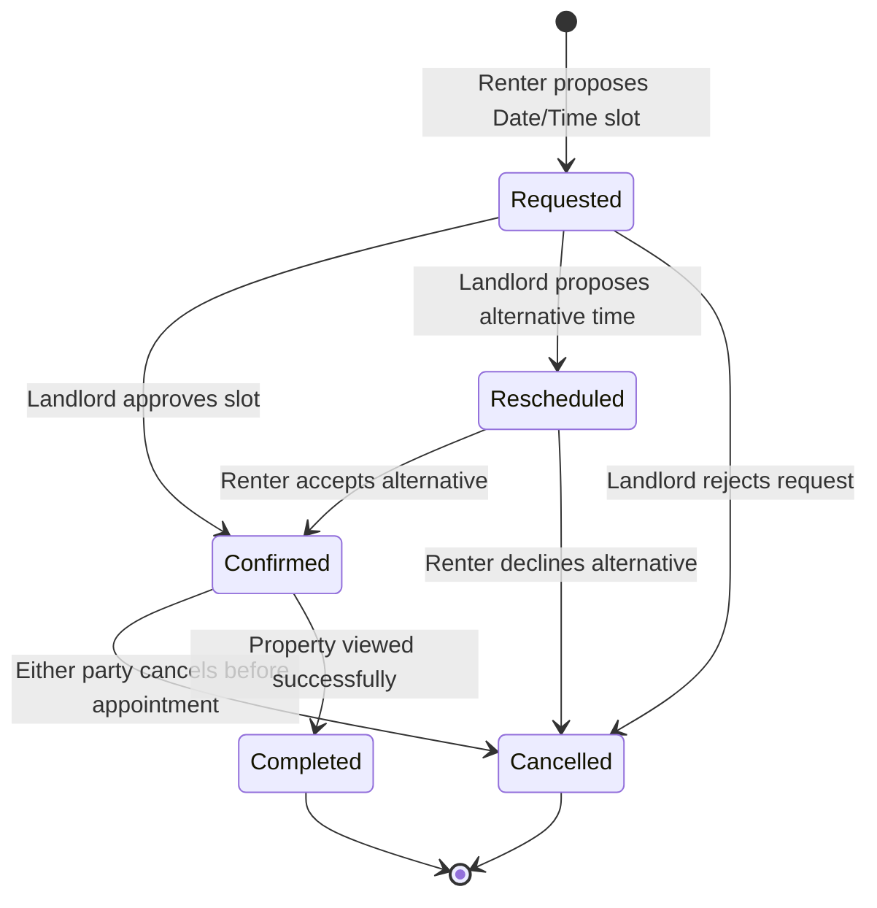
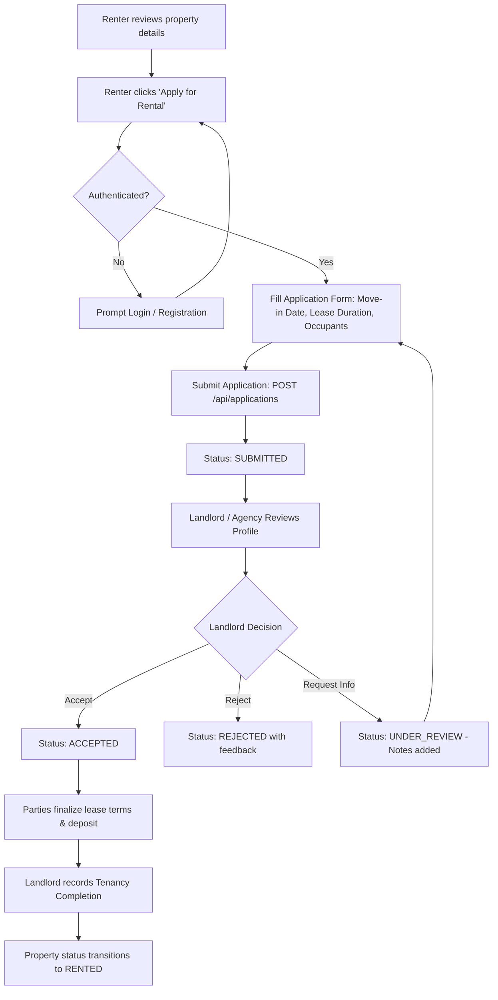

# ETrental: Renter Dashboard and Search Workflow

**Project Name:** ETrental — Online Rental Property Marketplace  
**Target Market:** Ethiopia (Prices in Ethiopian Birr — ETB)  
**Reference Website:** Rentola (`https://rentola.com.br`)  
**Document Reference:** `ETrental_Renter_Dashboard_and_Search_Workflow.md`  
**Version:** 1.0.0-PROPOSAL  
**Author:** Pair Programming Agentic Assistant  
**Date:** October 2026  

---

## 1. Public Homepage & Discovery Experience

The public discovery interface is the renter's primary gateway into ETrental. It mirrors the clean, high-conversion visual design of Rentola while incorporating Ethiopian urban geography and cultural property distinctions.

```
+-----------------------------------------------------------------------------------------+
|  [ ETrental Logo ]     Browse Listings    Add Property    For Agencies    [ Login / Register ] |
+-----------------------------------------------------------------------------------------+
|                                                                                         |
|       FIND YOUR NEXT HOME IN ETHIOPIA — SIMPLE, VERIFIED, DIRECT                        |
|       Discover apartments, villas, and condominiums across Addis Ababa and beyond       |
|                                                                                         |
|   +---------------------------------------------------------------------------------+   |
|   | City/Subcity: [ Addis Ababa, Bole v ]   Type: [ All Types v ]   Price: [ Max ETB v ] | [ Search ] |
|   +---------------------------------------------------------------------------------+   |
|                                                                                         |
|   Popular Localities:  [Bole]  [CMC]  [Kazanchis]  [Sarbet]  [Old Airport]  [Hawassa]    |
+-----------------------------------------------------------------------------------------+
|  Featured Properties in Addis Ababa              [ View All (1,240) -> ]                |
|  +--------------------+  +--------------------+  +--------------------+                 |
|  | [ Image Carousel ] |  | [ Image Carousel ] |  | [ Image Carousel ] |                 |
|  | 35,000 ETB / month |  | 65,000 ETB / month |  | 18,000 ETB / month |                 |
|  | 2 Bed • 2 Bath     |  | 3 Bed • 3 Bath     |  | 1 Bed • 1 Bath     |                 |
|  | Bole Medhanealem   |  | Old Airport Villa  |  | CMC Condominium    |                 |
|  | [♥ Save] [Details] |  | [♥ Save] [Details] |  | [♥ Save] [Details] |                 |
|  +--------------------+  +--------------------+  +--------------------+                 |
+-----------------------------------------------------------------------------------------+
```

### 1.1 Discovery Components
1. **Hero Search Bar:**
   - Autocomplete search by Region, City, Sub-city, or Neighborhood.
   - Quick filters for Property Type (`Apartment`, `Condominium`, `Villa`, `G+1`, `Studio`).
   - Budget quick selector (Min/Max ETB).
2. **Prominent Location Chips:** Instant navigation for high-demand Ethiopian rental hotspots (Bole, CMC, Kazanchis, Meganagna, Hawassa, Bahir Dar).
3. **Featured Listings Grid:** Curated, verified listings marked with a distinct badge.
4. **Trust & Safety Section:** Information on how listings are moderated, agent verification, and safety against rental scams.

---

## 2. Ethiopian Location Hierarchy & Search Engine

### 2.1 Geographic Hierarchy
The search engine utilizes a 3-tier geographic hierarchy:
- **Level 1: Region / Chartered City** (e.g., Addis Ababa, Oromia, Sidama, Amhara, Dire Dawa).
- **Level 2: City / Sub-City** (e.g., in Addis Ababa: Bole, Yeka, Kirkos, Arada, Nifas Silk-Lafto, Lideta, Kolfe Keranio, Gulele, Akaky Kaliti, Addis Ketema).
- **Level 3: Neighborhood / Landmark** (e.g., Bole Medhanealem, Atlas, Rwanda, CMC Michael, Figa, Kazanchis Total, Sarbet Vatican, Old Airport, Ayat Zone 3, Gerji Mebrat Hail).

### 2.2 Advanced Filter Parameters
The search API (`GET /api/properties/search`) supports comprehensive filtering:
- `city` (string): Target city name.
- `subCity` (string): Target sub-city name.
- `neighborhood` (string, optional): Specific neighborhood substring.
- `minPrice` / `maxPrice` (decimal): Monthly rent range in ETB.
- `bedrooms` (int, optional): Minimum required bedrooms (e.g., Studio = 0, 1, 2, 3, 4+).
- `bathrooms` (int, optional): Minimum required bathrooms.
- `propertyType` (enum): Apartment, Condominium, Villa, GPlusOne, Studio, Commercial, ServiceQuarter.
- `furnishingStatus` (enum): Unfurnished, SemiFurnished, FullyFurnished.
- `amenities` (array): BackupGenerator, WaterTank, SecurityGuard, Elevator, Parking, Balcony, Wi-Fi.
- `advanceMonths` (int, optional): Maximum advance rent requirement tolerated by renter (e.g., max 3 months).
- `sortBy` (enum): `Newest`, `PriceAsc`, `PriceDesc`, `MostPopular`.
- `page` & `pageSize`: Standard pagination controls.

---

## 3. Search Results & Property Details Specification

### 3.1 Rentola-Inspired Property Card
Each property card in the search listing presents:
- **Image Carousel:** High-resolution cover photo with thumbnail navigation.
- **Price Badge:** Prominently rendered in Ethiopian Birr (e.g., `45,000 ETB / month`).
- **Advance Terms Pill:** e.g., `3 Mo. Advance + 1 Mo. Deposit`.
- **Key Attributes:** Bed count, bath count, floor area ($m^2$).
- **Verification Badge:** `Verified Landlord` or `Verified Agency`.
- **Favorite Toggle:** Interactive heart icon (authenticates user, checks subscription limit).
- **Direct Navigation:** Clickable card routing to `/properties/{id}`.

### 3.2 Property Details Page (`/properties/:id`)
1. **Interactive Photo Gallery:** Fullscreen modal with high-definition image pan and gallery thumbnails.
2. **Key Specs Ribbon:** Rent (ETB), Deposit, Minimum Lease, Available From date, Furnishing status.
3. **Neighborhood & Proximity:** Detailed location description, nearby landmarks (e.g., "5 min walk from Edna Mall").
4. **Amenities Grid:** Visual icons indicating reserve water tank, generator, guard house, parking spaces.
5. **Host Contact Card:**
   - Profile photo, verification status, and response time badge.
   - Action buttons: `Send Inquiry`, `Schedule Viewing`, `Apply Now`.
   - Contact phone number (revealed according to Free/Premium subscription entitlement).
6. **Report Listing:** Direct modal to flag duplicate, fake, or incorrect rental listings to the admin moderation team.

---

## 4. Renter Dashboard Functional Specification

The authenticated renter dashboard (`/renter/dashboard`) provides a single pane of glass for managing the entire rental journey:

```
+------------------------------------------------------------------------------------+
|  [ETrental]   Browse Properties   [Search Alerts (2)]   [Messages (1)]  [User Profile] |
+------------------------------------------------------------------------------------+
|  RENTER PORTAL                                                                     |
|  [ Overview ]  [ My Favorites (4) ]  [ Saved Searches ]  [ My Inquiries (2) ]      |
|  [ Viewings (1) ]  [ Applications (1) ]  [ My Subscription: Free ]                 |
+------------------------------------------------------------------------------------+
|  Active Activity Summary:                                                          |
|  • 1 Viewing Appointment confirmed for Saturday 10:00 AM (Bole Villa)              |
|  • 1 Landlord replied to your inquiry (CMC Condominium)                            |
|  • 3 new listings match your saved search: "Bole 2-Bed < 40,000 ETB"               |
+------------------------------------------------------------------------------------+
```

### 4.1 Dashboard Modules

#### 4.1.1 Overview & Statistics
- Summary counter cards: Active Favorites, Saved Searches, Open Inquiries, Scheduled Viewings, Submitted Applications.
- Recent activity timeline and upcoming appointments.

#### 4.1.2 My Favorites
- Displays all saved property cards.
- Real-time status notifications: if a favorited property changes price, becomes `Rented`, or is marked `Unavailable`, an automatic badge is displayed.
- **Entitlement Rule:** Free users can save up to 5 properties; Premium users enjoy unlimited favorites.

#### 4.1.3 Saved Searches & Property Alerts
- Renters can save frequent filter combinations (e.g., "Addis Ababa - Yeka - 2 Bed - Max 30,000 ETB").
- Frequency options: `Instant Notification`, `Daily Digest`, or `Off`.
- Renters can activate/pause alerts or delete saved criteria anytime.

#### 4.1.4 My Inquiries & Communication
- Dedicated message center organizing inquiries by property.
- Renters can view landlord responses, send follow-up questions, and track inquiry resolution.
- Anti-spam safeguard: Free users can send up to 3 inquiries per week; Premium users receive unlimited inquiries.

#### 4.1.5 Viewing Appointments
- Status Tracker: `Requested` $\rightarrow$ `Confirmed` / `Rescheduled` / `Cancelled` $\rightarrow$ `Completed`.
- Renters can select preferred date/time slots, propose alternatives if rescheduled by the landlord, and cancel with an optional reason.

#### 4.1.6 Rental Applications
- Renters can submit standardized digital rental applications for eligible properties.
- Data captured: Desired move-in date, lease duration (months), proposed occupants count, employment/income summary, and optional identification reference.
- Status stages: `Submitted`, `Under Review`, `Accepted`, `Rejected`, `Withdrawn`.

#### 4.1.7 Subscription & Plan Management
- Current tier status: `Free` or `Premium`.
- Expiration date and feature allowance gauges (Inquiries used, Favorites used).
- Prominent upgrade button initiating the Ethiopian payment flow.

---

## 5. Renter Workflow Mermaid Diagrams

### 5.1 Search and Discovery Workflow



### 5.2 Property Inquiries and Communication Flow



### 5.3 Viewing Appointment Lifecycle



### 5.4 Rental Application & Completion Workflow



---

## 6. Error States, Loading & Accessibility Standards

1. **Skeleton Loaders:** Angular components display shimmering skeleton cards during API fetches for property grids and detail carousels.
2. **Empty States:** When no properties match a search, the UI displays clear, friendly messaging with recommendations:
   - "No properties found in Bole matching your criteria. Try widening your price range or exploring nearby sub-cities like Yeka or Kirkos."
3. **Responsive Design:** 100% responsive down to 320px mobile viewport, optimizing touch targets for mobile browsing common in Ethiopia.
4. **Currency Formatting:** All monetary outputs pass through a custom `EtbCurrencyPipe` formatting numbers with Ethiopian Birr symbols and standard thousand separators (e.g., `45,000 ETB`).
