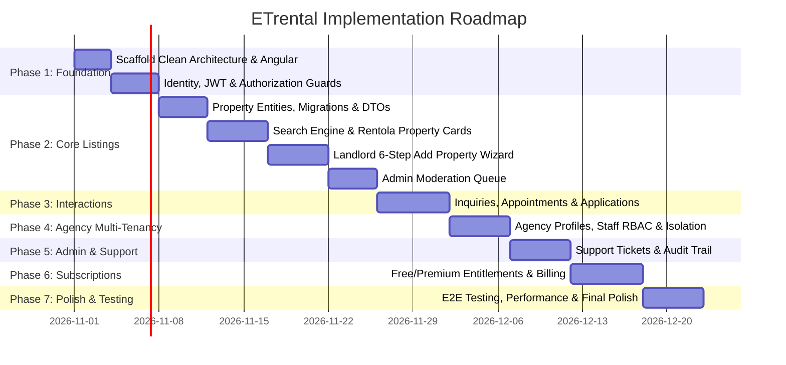

# ETrental: Test Cases & Phased Implementation Roadmap

**Project Name:** ETrental — Online Rental Property Marketplace  
**Target Market:** Ethiopia (Prices in Ethiopian Birr — ETB)  
**Document Reference:** `ETrental_Test_Cases_and_Implementation_Roadmap.md`  
**Version:** 1.0.0-PROPOSAL  
**Author:** Pair Programming Agentic Assistant  
**Date:** October 2026  

---

## 1. Comprehensive Test Suite Catalog

This test matrix validates all security invariants, role boundaries, business rules, and error handling across both backend Web API and Angular frontend.

### 1.1 Security & Role Authorization Tests (TC-AUTH)

| Test ID | Test Scenario | Actor Role | Preconditions | Steps to Execute | Expected Result | Priority |
|---|---|---|---|---|---|---|
| **TC-AUTH-001** | Renter accesses Landlord endpoint | Renter | Authenticated with valid Renter JWT | `POST /api/properties` with valid property payload | Returns `403 Forbidden`. No property is created. | Critical |
| **TC-AUTH-002** | Landlord edits peer landlord's listing (IDOR) | Landlord A | Authenticated as Landlord A; Property #99 owned by Landlord B | `PUT /api/properties/99` with updated title | Returns `403 Forbidden` or `404 Not Found`. Modification blocked. | Critical |
| **TC-AUTH-003** | Agency cross-tenant isolation | Agency Agent A | Authenticated in Agency A (ID: 101); Listing #50 owned by Agency B (ID: 202) | `GET /api/agency/properties/50` or `PUT /api/agency/properties/50` | Returns `404 Not Found` (query filtered by tenant boundary). No data exposed. | Critical |
| **TC-AUTH-004** | Support agent attempts listing approval | Support | Authenticated with `Support` role | `POST /api/admin/moderation/properties/12/approve` | Returns `403 Forbidden`. Approval strictly reserved for `Admin`. | High |
| **TC-AUTH-005** | Support agent accesses user password | Support | Authenticated with `Support` role | `GET /api/support/users/42` | Returns user contact and profile only; password hashes and reset tokens are excluded. | Critical |
| **TC-AUTH-006** | Unauthenticated user queries protected dashboard | Anonymous | No Bearer token provided | `GET /api/renter/dashboard` or `GET /api/landlord/properties` | Returns `401 Unauthorized`. | Critical |

### 1.2 Property Lifecycle & Moderation Tests (TC-PROP)

| Test ID | Test Scenario | Actor Role | Preconditions | Steps to Execute | Expected Result | Priority |
|---|---|---|---|---|---|---|
| **TC-PROP-001** | Unapproved listing visibility in public search | Anonymous / Renter | Property #15 is in `PENDING_REVIEW` | `GET /api/properties/search?city=Addis+Ababa` and `GET /api/properties/15` | Property #15 does not appear in search results; direct GET returns `404 Not Found`. | Critical |
| **TC-PROP-002** | Listing submission with fewer than 3 photos | Landlord | Property draft initialized | `POST /api/properties/12/submit-review` with only 2 photos uploaded | Returns `400 Bad Request` with message: *"Minimum of 3 property photos required."* | High |
| **TC-PROP-003** | Malicious file upload prevention | Landlord | Authenticated | `POST /api/properties/upload-image` with `.php` or `.exe` renamed to `.jpg` | Magic-byte validator detects non-image payload; returns `400 Bad Request`. | Critical |
| **TC-PROP-004** | Admin listing rejection with mandatory reason | Admin | Property in `PENDING_REVIEW` | `POST /api/admin/moderation/properties/12/reject` with empty reason | Returns `400 Bad Request`. Rejection requires valid category and comment. | High |
| **TC-PROP-005** | Unauthorized direct status bypass | Landlord | Property in `DRAFT` | `PUT /api/properties/12` with payload `{ status: "PUBLISHED" }` | Backend ignores status field in generic update DTO; status remains `DRAFT`. | Critical |

### 1.3 Rental Interactions & Appointments (TC-RENT)

| Test ID | Test Scenario | Actor Role | Preconditions | Steps to Execute | Expected Result | Priority |
|---|---|---|---|---|---|---|
| **TC-RENT-001** | Free user exceeds favorites quota | Renter (Free) | User already has 5 active favorites | `POST /api/renter/favorites/88` | Returns `403 Forbidden` with upgrade prompt: *"Free limit of 5 favorites reached."* | High |
| **TC-RENT-002** | Weekly inquiry rate-limiting | Renter (Free) | User sent 3 inquiries this week | `POST /api/inquiries` for a 4th property | Returns `429 Too Many Requests` or `403 Forbidden` prompting upgrade. | High |
| **TC-RENT-003** | Viewing appointment scheduling | Renter | Property is `PUBLISHED` | `POST /api/appointments` with future date/time | Creates appointment with status `REQUESTED`; landlord receives notification. | High |
| **TC-RENT-004** | Mark property as rented | Landlord | Property is `PUBLISHED` with 2 applications | `POST /api/landlord/properties/12/mark-rented` with lease data | Property status transitions to `RENTED`; pending applicants notified. | High |

### 1.4 Subscription & Payment Verification (TC-SUB)

| Test ID | Test Scenario | Actor Role | Preconditions | Steps to Execute | Expected Result | Priority |
|---|---|---|---|---|---|---|
| **TC-SUB-001** | Client callback spoofing prevention | Renter | User initiated checkout | User crafts `POST /api/subscriptions/confirm` with fake `status=SUCCESS` | Returns `400 Bad Request`. Activation strictly requires verified gateway signature. | Critical |
| **TC-SUB-002** | Subscription expiration entitlement revocation | System | User's Premium subscription expires | Cron / background worker runs at expiration time | Status transitions from `ACTIVE` to `EXPIRED`. Restrictive quotas re-applied. | Critical |
| **TC-SUB-003** | Idempotent payment webhook processing | Payment Gateway | Transaction #TX-901 received | Send identical webhook notification twice | First call activates subscription; second call detects idempotency key and returns `200 OK` without duplicating. | Critical |

---

## 2. Acceptance Testing Criteria (Gherkin Scenarios)

### Scenario A: Renter Searches for 2-Bedroom Apartment in Bole
```gherkin
Feature: Property Search and Filtering
  As a prospective tenant in Addis Ababa
  I want to filter available properties by sub-city, bedrooms, and budget
  So that I can quickly discover suitable rental accommodations.

  Scenario: Filter properties in Bole under 50,000 ETB
    Given the platform contains approved and published rental properties
    When the renter enters "Addis Ababa" and sub-city "Bole"
    And sets maximum price to "50000" ETB
    And selects bedrooms "2"
    And clicks "Search"
    Then the search results grid displays only listings located in Bole Sub-city
    And every displayed listing has monthly rent less than or equal to 50,000 ETB
    And every displayed listing has at least 2 bedrooms
    And all displayed listings have status "PUBLISHED".
```

### Scenario B: Landlord Submits New Property for Review
```gherkin
Feature: Landlord Listing Submission
  As an Ethiopian property owner
  I want to submit my rental property details with photos
  So that it can be reviewed and published on ETrental.

  Scenario: Successful submission of condominium listing
    Given an authenticated Landlord on the "Add Property" page
    When the landlord completes Step 1 with title "Modern 2-Bed Condominium in CMC"
    And specifies location "Addis Ababa", "Yeka", "CMC Michael"
    And specifies monthly rent "28000" ETB with 3 months advance required
    And selects amenities "Reserve Water Tank" and "Compound Security"
    And uploads 5 high-resolution JPEG photographs
    And clicks "Submit for Review"
    Then the property is saved with status "PENDING_REVIEW"
    And the landlord sees a confirmation banner "Listing submitted for review"
    And the listing does not appear in public renter searches until approved by Admin.
```

---

## 3. Phased Implementation Roadmap

The implementation is structured into seven sequential phases, adhering strictly to Clean Architecture separation of concerns:



### Detailed Phase Breakdown

#### Phase 1: Foundation & Security Infrastructure
- Scaffold ASP.NET Core solution (`ETrental.sln`) with 4 Clean Architecture projects:
  - `ETrental.Domain`
  - `ETrental.Application`
  - `ETrental.Infrastructure`
  - `ETrental.Presentation`
- Scaffold modern Angular application in `frontend/` with standalone components, routing, and Tailwind CSS/custom styles.
- Implement ASP.NET Core Identity with custom `User` entity, JWT token generation, refresh tokens, and claim-based RBAC.
- Configure global exception handling middleware, CORS policy, and security headers.

#### Phase 2: Core Rental Experience & Property Lifecycle
- Model `Property`, `PropertyImage`, and `Amenity` entities with EF Core configurations and Fluent API.
- Create database seeder for Ethiopian administrative regions, sub-cities, and initial admin credentials.
- Build high-performance filtered search API with pagination, indexing, and sorting in ETB.
- Develop the public discovery homepage, Rentola-style responsive property cards, and interactive detail pages in Angular.
- Implement the 6-step reactive "Add Property" wizard with image upload, client-side validation, and server-side magic-byte verification.
- Implement administrative listing review queue with approval, rejection categories, and correction requests.

#### Phase 3: Rental Communication & Tenancy Workflow
- Implement Renter Favorites (with quota enforcement) and Saved Search alerts.
- Develop in-app Inquiry Messaging center linking renters with property hosts.
- Build the Viewing Appointment scheduler supporting request, confirmation, and reschedule workflows.
- Implement the Rental Application workflow enabling tenant screening and status updates.
- Create the "Mark as Rented" completion modal updating property availability and recording tenancy terms.

#### Phase 4: Corporate Agency Multi-Tenancy
- Implement `Agency`, `AgencyMembership`, and `AgencyStatus` entities.
- Enforce strict tenant isolation using EF Core Global Query Filters (`AgencyId == currentUserService.AgencyId`).
- Build agency staff invitation system with roles: `AGENCY_MANAGER`, `AGENT`, and `VIEWER`.
- Develop Agency Portfolio Management allowing managers to assign properties to specific agents.
- Create agency operational reports (vacancy rate, agent response velocity).

#### Phase 5: Administration, Safety & Support Operations
- Build Admin Governance Dashboard with platform KPIs (Total Users, Listings, Moderation Queue).
- Create Trust & Safety reporting system for flagging fraudulent or duplicate listings.
- Develop Customer Support Desk featuring ticket management with strict separation of public replies vs private internal staff notes.
- Implement immutable `AuditLogs` recording all administrative interventions.

#### Phase 6: Subscriptions & Ethiopian Payment Readiness
- Create `SubscriptionPlan` and `Subscription` entities defining Free vs Premium entitlements.
- Implement server-side entitlement enforcement engine (e.g., favorite limits, inquiry limits, phone number reveal).
- Prepare checkout integration architecture ready for Ethiopian payment rails (Telebirr, Chapa, CBE Birr) using idempotent webhooks.
- Build Renter Subscription Management UI for plan upgrades, status tracking, and receipt history.

#### Phase 7: Hardening, Verification & Capstone Presentation
- Execute automated integration and security test suite covering IDOR, tenant leakage, and role guards.
- Implement Ethiopian localization enhancements (Amharic / English toggle readiness).
- Optimize Lighthouse performance scores (CWV, image lazy loading, responsive breakpoints).
- Package complete final-year project documentation, architecture diagrams, and database setup instructions.

---

## 4. Key Architectural Decisions Requiring User Approval

Before initiating code generation and package installations, the following business and architectural decisions are submitted for your confirmation:

1. **Database Provider:**
   - *Option A (Recommended for Local Dev & Defense):* Microsoft SQL Server (LocalDB or Docker container) via EF Core.
   - *Option B:* SQLite for zero-configuration, self-contained single-file demonstration.
2. **Payment Gateway Integration:**
   - *Option A (Recommended for Ethiopia):* Chapa API (popular Ethiopian fintech aggregator supporting Telebirr, CBE Birr, Awash, cards).
   - *Option B:* Mock payment provider with test simulation mode for academic evaluation.
3. **Styling Framework for Angular Frontend:**
   - *Option A (Recommended):* Tailwind CSS for rapid, modern, utility-first responsive styling matching Rentola.
   - *Option B:* Angular Material / Bootstrap components.

---

## 5. Absolute Stop Condition

In strict accordance with the mandatory working rules:
- **No source code has been altered.**
- **No dependencies have been installed.**
- **No migrations or database commands have been executed.**
- **All seven comprehensive specification documents have been successfully generated and placed in the project root.**

We await your explicit review and approval of the architectural plan and open decisions before commencing implementation.
